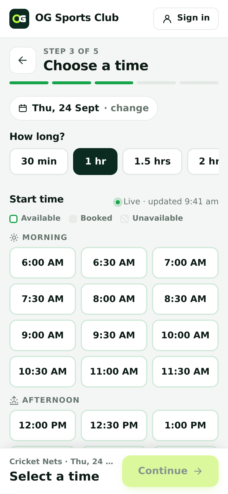
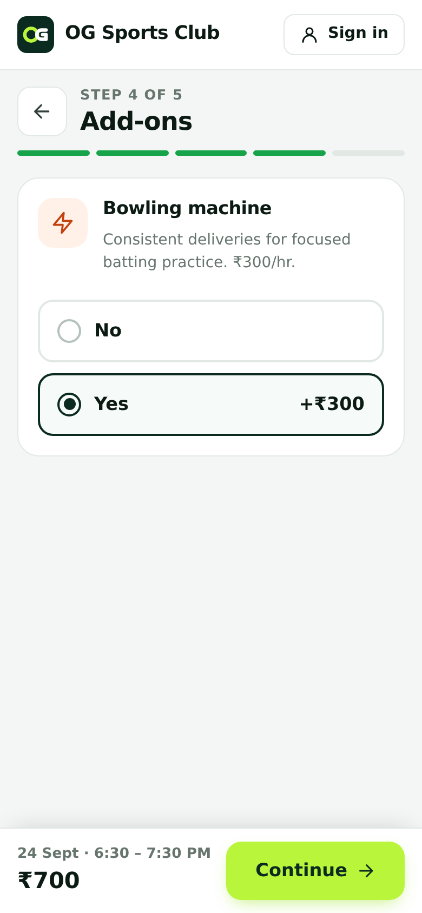
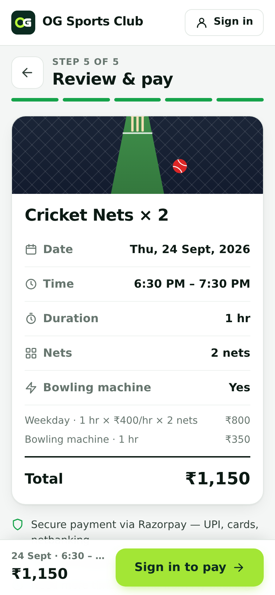
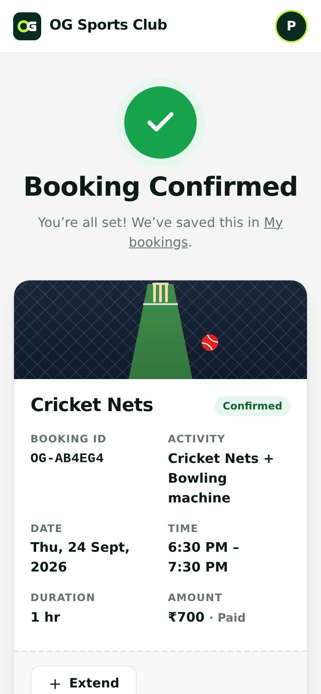
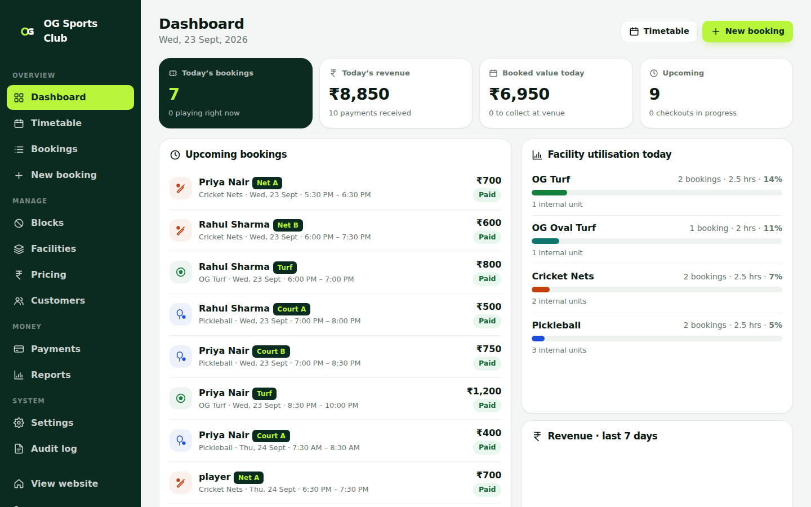
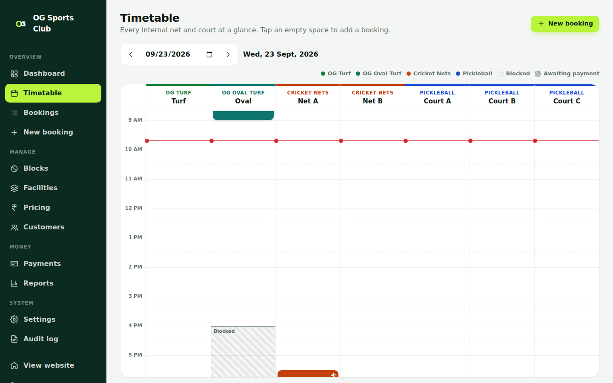

# OG Sports Club — Online Booking

A production-ready booking website for a sports club with **OG Turf, OG Oval Turf, Cricket Nets and Pickleball**.
Customers book in a few taps on their phone and pay with UPI. The owner runs everything from a secure admin dashboard.

**Stack:** React 19 + Vite · Node.js + Express 5 · PostgreSQL · Clerk (auth) · Razorpay (UPI, cards, netbanking) · Render

| Choose a time | Bowling machine (nets only) | Review & pay | Confirmed |
|---|---|---|---|
|  |  |  |  |




---

## What customers see

| Customers see | Behind the scenes (never shown to customers) |
|---|---|
| OG Turf | 1 unit: *Turf* |
| OG Oval Turf | 1 unit: *Oval* |
| Cricket Nets | 2 units: *Net A*, *Net B* |
| Pickleball | 3 units: *Court A*, *Court B*, *Court C* |

A time is **available** if *any* unit of that facility is free for the whole duration. Customers can book **several units
at once** ("How many nets? 1 net / 2 nets", "How many courts? 1–3"); the time grid then only offers start times where
that many are free, and shows "Only 1 free" where fewer are. When the customer pays, the server assigns free units automatically. It uses best fit, so gaps between bookings stay bookable. Customer API responses
never include unit names or IDs.

### Booking flow (mobile-first)
1. **Choose your activity**: four large cards.
2. **Choose a date**: a swipeable strip of dates, plus a full calendar.
3. **Choose a time**: pick a duration (30 min, 1 hr, 1.5 hrs…), how many nets or courts (Cricket Nets and Pickleball only), then any free start time. Start times are flexible, not fixed hourly slots: 7:00, 7:30, 8:15, 9:00–10:30 and so on. Booked and blocked times are greyed out. Availability refreshes every 20 seconds.
4. **Bowling machine** (Cricket Nets only): *No* / *Yes (+₹300)*. This step doesn't exist for the other activities, and the server rejects the add-on for them too.
5. **Review & pay**: a clear summary with a price breakdown, then **Proceed to Payment** (Razorpay, UPI first).
6. **✓ Booking Confirmed**: Booking ID, activity, date, time, duration, amount and status, plus *Add to calendar*.

**My bookings** has three tabs: Upcoming, Past and Cancelled. Customers can **cancel** (refund follows your policy) and
**extend by 30 min or 1 hr** when the next period on the *same* net or court is free.

## What the owner gets (`/admin`)
- **Dashboard**: today's bookings, today's revenue, upcoming bookings, utilisation per facility, and a 7-day revenue chart.
- **Timetable**: every net and court as a column, bookings as colored blocks, blocked time hatched, and a "now" line. Tap an empty space to add a booking there.
- **Bookings**: search and filter, see the assigned unit, edit, move or resize, reassign a unit, record a cash or UPI payment, and cancel with a refund.
- **New booking**: manual booking for phone and walk-in customers, with auto or chosen unit, pay-at-venue or paid, and a custom amount.
- **Blocks**: block a whole facility or a single net or court, once or on a recurring schedule (e.g. Mon/Wed/Fri 4–6 PM coaching). Any existing bookings that clash are listed.
- **Facilities**: names, descriptions, photos, opening hours, start-time interval, min/max duration and step, how far ahead customers can book, and minimum notice. You can also set the bowling machine price and how many machines you have, and add, rename or deactivate nets and courts.
- **Pricing**: rules by day and time with priorities (e.g. weekday day ₹600, evening ₹800, weekend ₹1000), with a live price preview.
- **Customers**: search, booking history and total spend, make admin, suspend.
- **Payments**: every online and desk payment, and one-click refunds.
- **Reports**: revenue by day, facility and payment method, busiest hours, and CSV export.
- **Settings**: club details (address, phone, WhatsApp, map link) and booking policy (payment hold, cancellation cut-off, refund %, extension options).
- **Audit log**: who changed what, and when.

---

## Security & correctness

- **No double bookings, ever.** Every booking change runs in a transaction that holds a per-facility advisory lock. PostgreSQL `EXCLUDE USING gist` constraints also make overlapping live bookings on the same unit impossible at the database level. Tested with 12 simultaneous requests for one slot: exactly one wins (two for the nets).
- **Blocks enforced** for both one-off and recurring blocks, at facility or unit level.
- **Server-side prices.** The client never sends an amount. Prices are computed per 5-minute slice from your price rules.
- **Payment holds.** An unpaid booking holds the slot for 10 minutes (configurable), then releases it automatically. If a payment arrives late, the slot is re-reserved when it's still free; otherwise the customer is refunded automatically.
- **Payments verified server-side.** The Razorpay HMAC signature is checked, then the server fetches the payment to confirm the order, amount and capture. Webhooks are signature-verified and idempotent.
- **Permissions.** Customers can only see and change their own bookings. `/api/admin/*` requires `role = admin`, which is checked on every request.
- **Bowling machine** is enforced on the server: only for facilities with `supports_bowling_machine`, and limited by how many machines you have.
- Secrets live only on the server (`.env.example` lists them all). Also in place: security headers, rate limiting, input validation, parameterised SQL, CSV formula-injection protection, and a full audit trail.

---

## Run it locally

Requirements: Node 20+ and PostgreSQL 14+.

```bash
git clone <your-repo> og-sports-club && cd og-sports-club
cp .env.example .env              # then edit values
createdb og_sports                # or use any Postgres URL in DATABASE_URL
npm run install:all

# terminal 1 – API on :4000 (runs migrations + seeds facilities on first start)
npm run dev:server
# terminal 2 – website on :5173 (proxies /api to :4000)
npm run dev:client
```

**Quick local test without Clerk or Razorpay accounts.** Set these in `.env`:
```
DEV_AUTH=true
VITE_CLERK_PUBLISHABLE_KEY=
CLERK_SECRET_KEY=
PAYMENT_PROVIDER=mock
SEED_DEMO_DATA=true
ADMIN_EMAILS=owner@ogsports.test
```
The sign-in button then shows a development sign-in with *Demo customer* and *Demo owner (admin)* buttons, and payment
opens a test dialog. Both are **refused by the server in production**.

Tests: `npm test` runs the unit tests for pricing, time zones, resource assignment, bowling-machine limits and signatures.

---

## Set up Clerk (login/signup)
1. Create an application at <https://dashboard.clerk.com> and turn on Email and/or Phone and Google sign-in.
2. **API Keys**: copy the *Publishable key* into `VITE_CLERK_PUBLISHABLE_KEY` and the *Secret key* into `CLERK_SECRET_KEY`.
3. Put your own email in `ADMIN_EMAILS`. The first time you sign in with it, you become an admin. You can then grant admin to staff from **Admin → Customers**.
4. For production, add your domain in Clerk (**Domains**) and switch to production keys.

## Set up Razorpay (UPI payments)
1. Create an account at <https://dashboard.razorpay.com>. Use **Test mode** first.
2. **Settings → API Keys**: copy them into `RAZORPAY_KEY_ID` and `RAZORPAY_KEY_SECRET`.
3. **Settings → Webhooks → Add**: URL `https://YOUR-DOMAIN/api/webhooks/razorpay`, a secret (copy it into `RAZORPAY_WEBHOOK_SECRET`), and these events: `payment.captured`, `payment.failed`, `order.paid`, `refund.processed`.
4. **Settings → Payment capture**: set to *Automatic*. The app also captures as a fallback.
5. UPI (GPay, PhonePe, Paytm, any UPI ID or QR code) is shown first in checkout. Cards, netbanking and wallets are still available.

## Deploy on Render (from GitHub)
1. Push this folder to a GitHub repository.
2. Render → **New → Blueprint** → choose the repo. `render.yaml` creates:
   - **og-sports-db**: PostgreSQL
   - **og-sports-club**: a web service that builds the React app and runs the API, which also serves the site
3. Fill in the secret values when asked: `PUBLIC_URL`, `ADMIN_EMAILS`, `CLERK_SECRET_KEY`, `VITE_CLERK_PUBLISHABLE_KEY`, `RAZORPAY_KEY_ID`, `RAZORPAY_KEY_SECRET` and `RAZORPAY_WEBHOOK_SECRET`.
4. Deploy. Migrations run automatically on start, and the four facilities, their units and default prices are created on first boot.
5. Set the Razorpay webhook URL to your Render URL (or your custom domain), and add the same domain in Clerk.
6. Sign in with your admin email, then go to **Admin → Settings** (address, phone, map link) and **Admin → Pricing** (your real prices).

> `PUBLIC_URL` must be the address customers actually use (e.g. `https://book.ogsports.in`), because Clerk only accepts
> sessions from those origins. Put any additional domains in `CORS_ORIGINS`.

Health check: `GET /healthz`. Build: `npm run build`. Start: `npm start`.

---

## Project structure
```
├── render.yaml            Render blueprint (web service + Postgres)
├── .env.example           every environment variable, documented
├── server/
│   ├── src/index.js       Express app, security headers, static hosting, hold sweeper
│   ├── src/config.js      validated config (refuses unsafe production settings)
│   ├── src/db/            migrations (schema + EXCLUDE constraints) and first-run seed
│   ├── src/middleware/    Clerk auth + role checks
│   ├── src/services/      availability, pricing, bookings, payments (Razorpay), settings, audit
│   ├── src/routes/        public, customer, admin, webhooks
│   └── test/              unit tests (node --test)
└── client/
    ├── src/pages/         Home, Book (5-step wizard), BookingDetail, MyBookings
    ├── src/pages/admin/   Dashboard, Timetable, Bookings, New booking, Blocks, Facilities, Pricing, Customers, Payments, Reports, Settings, Audit
    ├── src/components/    UI kit, calendar, sport illustrations, booking actions
    └── src/lib/           API client, auth (Clerk), Razorpay checkout, router, formatting
```

### Database tables
`users`, `facility_groups`, `resources`, `pricing`, `bookings`, `booking_extensions`, `blocked_slots`, `recurring_blocks`,
`payments`, `audit_logs`, plus `booking_units` (which nets/courts each booking holds; the overlap guard lives here), `settings` (club details and policy) and `webhook_events` (webhook idempotency).
Money is stored as integer **paise**. Times are stored as `timestamptz` and shown in `CLUB_TIMEZONE` (default Asia/Kolkata).

### Main API
| Method | Path | Who |
|---|---|---|
| GET | `/api/facilities`, `/api/facilities/:slug`, `/api/facilities/:slug/availability?date=` | public |
| POST | `/api/quote` | public (price and availability check) |
| GET/POST | `/api/bookings`, `/api/bookings/:id`, `/api/bookings/:id/{pay,cancel,extensions}` | signed-in customer (own bookings only) |
| POST | `/api/payments/verify`, `/api/payments/failed` | signed-in customer |
| POST | `/api/webhooks/razorpay` | Razorpay (signature-verified) |
| * | `/api/admin/*` | admins only |

## Default prices (edit in Admin → Pricing)
These are placeholders. Change them to your real prices before going live.

| Facility | Weekday day | Weekday evening (5 PM+) | Weekend |
|---|---|---|---|
| OG Turf | ₹600/hr | ₹800/hr | ₹1,000/hr |
| OG Oval Turf | ₹1,200/hr | ₹1,500/hr | ₹1,800/hr |
| Cricket Nets | ₹400/hr | ₹400/hr | ₹500/hr |
| Pickleball | ₹400/hr | ₹500/hr | ₹600/hr |
| Bowling machine add-on | +₹300/hr | | |
